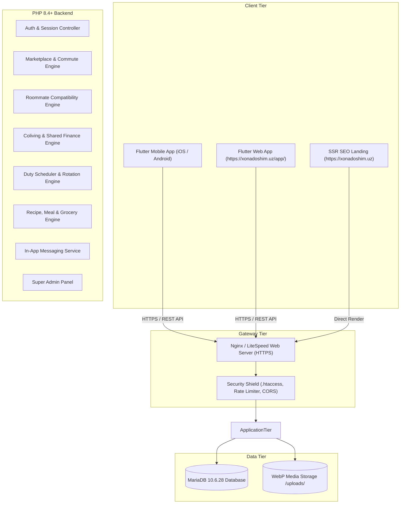

# XONADOSH — SYSTEM ARCHITECTURE SPECIFICATION
**Version:** 2.0 Production  
**Lead Architect:** Principal System Architect  
**Domain:** `https://xonadoshim.uz`  

---

## 1. High-Level Architecture Overview

XonaDosh follows a Decoupled Modular Service Architecture optimized for high reliability, fast response times, and frictionless execution on shared and VPS hosting environments without requiring expensive microservice dependencies.



---

## 2. Flutter Client Architecture (Mobile & Web)

The frontend is built with Flutter 3.47+ / Dart 3.13+ adhering to Clean Architecture principles:

```text
lib/
├── config/              # AppConfig (Base URL, Timeouts, Version)
├── core/                # Theme tokens, UI constants, formatters
├── data/
│   ├── api/             # HTTP clients, Token storage, SessionManager, Dio interceptors
│   ├── models/          # Immutable domain data models with JSON serialization
│   └── repositories/    # Data contracts isolating API calls from UI logic
├── domain/              # Pure business logic (UzPhone, MatchingAlgorithm, CommuteMath)
├── presentation/
│   ├── auth/            # Phone/OTP screens, OAuth buttons
│   ├── common/          # Reusable design tokens, buttons, app bars, dialogs
│   ├── features/xonadosh/
│   │   ├── tabs/        # HousingTab (Explore), MatchingTab (Roommates), ColivingTab (Squads)
│   │   ├── screens/     # MapScreen, ListingDetail, CreateListing, ChatScreen, Settings
│   │   └── widgets/     # TinderRoommateDeck, ListingCard, RecipePicker, ChoresDialog
│   ├── providers/       # State management via Riverpod StateNotifiers
│   └── router/          # AppRouter declarative navigation
└── l10n/                # Localization bundles (uz, ru, en)
```

### 2.1 State Management (Riverpod)
- `authProvider`: Manages user session state, authentication tokens, and profile verification badges.
- `housingProvider`: Manages listing feeds, active filters, map clusters, and pagination.
- `matchingProvider`: Handles candidate cards, Tinder swipe actions, match percentage calculations, and filter chips.
- `colivingProvider`: Handles household squads, active duty rotas, Splitwise expense ledger, meal planner, and grocery checklists.

---

## 3. Backend Architecture (PHP 8.4+ REST API)

### 3.1 Modular Controller Structure
The backend implements a lightweight, high-performance MVC/Modular structure avoiding heavy framework overhead to achieve sub-50ms execution times on shared CloudLinux hosting:

```text
backend/
├── api/                 # 36 Stateless REST API endpoints
│   ├── auth_*.php       # Registration, Login, OAuth, Session Refresh, Account Deletion
│   ├── xonadosh_*.php   # Marketplace, Matching, Chores, Recipes, Finances, Squads
│   └── chat_*.php       # Real-time conversations and messages
├── includes/
│   ├── bootstrap.php    # Error handlers, JSON headers, request parsers
│   ├── db.php           # Singleton PDO MySQL connection factory
│   ├── auth_lib.php     # Bearer token validation, password hashing, session store
│   └── xonadosh_lib.php # Roommate matching math, grocery calculations, commute helpers
├── admin/               # Super Admin Panel with CSRF protection and access gates
├── uploads/             # Media storage with strict .htaccess PHP execution denial
└── index.html           # High-converting SEO-optimized landing website
```

### 3.2 Security & Media Processing Pipeline
Uploaded photos (listing pictures, user avatars, receipt attachments) pass through a security pipeline:
1. File size limit enforcement (max 10MB).
2. MIME-type validation via `finfo` (allowing only JPEG, PNG, WEBP).
3. Automatic conversion into optimized **WebP** images via PHP `gd` / `imagewebp` at 82% quality, shrinking storage footprint by ~70% while improving mobile load times.
4. Storage in randomized hashed paths (`uploads/listings/{md5}.webp`), preventing directory traversal or direct script execution.

---

## 4. Hosting & Deployment Architecture

- **Domain:** `https://xonadoshim.uz`
- **SSL/TLS:** Automated Let's Encrypt / cPanel AutoSSL with HTTP/2 and modern cipher suites.
- **FTP Deployment Pipeline:** `scripts/deploy_ftp.py` provides targeted incremental or full deployments over TLS to `142.132.250.229:21`.
- **Flutter Web Deployment:** Compiled via `flutter build web --release --base-href /app/` and deployed directly to `public_html/app/`.
- **Database Engine:** Local MariaDB socket/TCP on `localhost:3306`, completely firewalled against outside internet probes.
